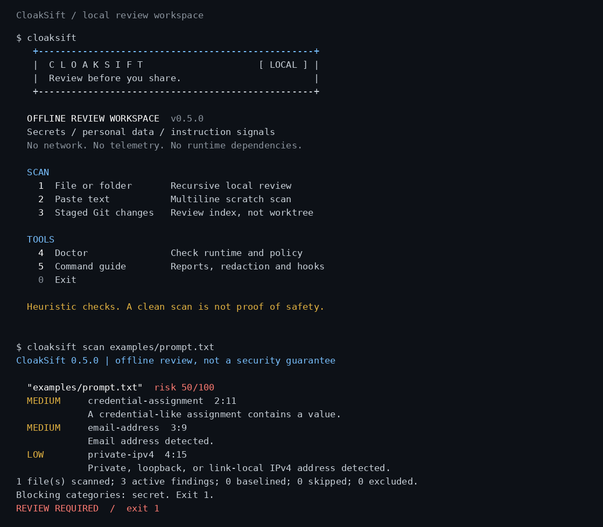

<div align="center">

# CloakSift

### Review before you share. Keep the scan on your machine.

**Offline CLI · Zero runtime dependencies · Node.js 20+ · MIT**

[Quick start](#quick-start) · [Commands](#everyday-commands) · [Coverage & limits](#detection-coverage) · [العربية](START-HERE-AR.md) · [Contributing](CONTRIBUTING.md)

</div>



*Real CLI output, rendered with synthetic example data. No real credentials shown.*

CloakSift checks local text for credential patterns, selected personal data and suspicious instruction phrases before you paste, share or commit it. Scan a file, review a folder, inspect staged Git changes, or prepare a redacted copy. Your input stays local: no account, API key, telemetry, model download or runtime network requests.

> **A review tool, not a security guarantee.** Detection and redaction are heuristic and incomplete. A clean scan is not proof of safety. CloakSift is not an AI firewall and does not intercept requests to AI providers. Always review prepared output before sharing it.

## Why CloakSift?

| Need | What you get |
| :--- | :--- |
| Review before a paste | Multiline terminal input, safe new-file redaction, explicit review refusal for instruction signals |
| Review a repository | Recursive scans, actual staged Git blobs, configurable blocking policy and opt-in reviewed baselines |
| Add a CI check | JSON/SARIF reports, documented exit codes, visible exclusions and incomplete-input failures |
| Stay in control | No runtime dependencies, no hidden uploads, no automatic clipboard access and no source-file rewrites |

## Quick start

Requires **Node.js 20+**, npm and Git. Clone this repository, then run the included compiled CLI, with no dependency installation:

```sh
git clone https://github.com/MalekMahmouda/cloaksift.git
cd cloaksift
node dist/cli.js
```

To install the short command from the cloned folder:

```sh
npm install -g . --offline --ignore-scripts --no-audit --no-fund
cloaksift
```

The installed CLI has no runtime dependencies. It is **not published to npm**: do not use `npm install -g cloaksift`. The package remains marked private to prevent accidental registry publication. `cloak-sift` is an alternative command name.

Try the synthetic fixture:

```sh
cloaksift scan examples/prompt.txt
# Exit 1 is expected: this file intentionally contains synthetic findings.
cloaksift doctor
```

Windows PowerShell: if script execution blocks a command, use `npm.cmd` and `cloaksift.cmd`. Reopen the terminal if PATH needs to refresh. On macOS/Linux, if global install gives EACCES, use a user-owned npm prefix or keep using `node dist/cli.js`. Do not install as administrator just to work around permissions.

The menu appears in a real terminal. Noninteractive no-argument invocation prints help. The workspace returns after each action, supports narrow terminals and uses color plus written status labels. Pasted text remains visible in terminal scrollback, so prefer a file for real secrets. A line containing `.scan` ends multiline input.

## Terminal behavior

Colors are automatic only on an interactive stdout TTY. Set `NO_COLOR` (even an empty value), or `TERM=dumb`, to disable ANSI styling. `FORCE_COLOR` does not override these protections. Pipes, `-o` reports, JSON, SARIF and redacted text are never decorated. Status and severity are always written in words, so colors are optional. There are no screen clears, cursor animations or network checks.

```sh
NO_COLOR=1 cloaksift scan examples/prompt.txt
# PowerShell: $env:NO_COLOR = "1"; cloaksift
```

## Everyday commands

```sh
cloaksift doctor
cloaksift scan examples/prompt.txt
cloaksift scan ./src ./notes
cloaksift scan --staged
cloaksift scan - --json
cloaksift scan ./src --block secret,pii,injection
cloaksift scan ./src --fail-on-risk 35
cloaksift scan ./src --format json -o new-report.json
cloaksift scan ./src --format sarif -o new-results.sarif
cloaksift prepare prompt.txt -o new-redacted.txt
cloaksift redact prompt.txt
cloaksift rules
cloaksift --help
```

- `scan` recursively reads files/folders, or stdin when piped. Reports contain metadata, rule IDs, one-based line/column, hashes and file paths, never matched values or source snippets. Filenames may still be sensitive. Findings can overlap.
- `--staged` reads actual Git index blobs, not working copies. It also works from a repository subfolder. Renames and unresolved entries are handled conservatively. Not a Git history scanner.
- `prepare` redacts secret/PII patterns, refuses all output if injection signals are found, and never modifies the source. It does not certify text as safe. Policy exclusions, rule disabling and baselines cannot weaken this command.
- `redact` redacts secret/PII patterns but leaves suspicious instruction phrases unchanged. For manual review only.
- `-o` creates a new report/redacted file, refuses existing destinations, and requests owner-only permissions where supported. Redirecting with `>` is your shell's behavior and can overwrite a file before the CLI starts; prefer `-o`.
- `rules` lists all detector metadata. `doctor` checks Node, Git availability and the current policy; it is not an environment security audit.
- No watch mode, proxy, middleware, model, cloud service, secret validation/rotation, automatic clipboard access or outbound API interception.

### Exit codes and limits

**0**: no active policy block, not proof of safety. **1**: blocking findings or prepare review refusal. **2**: invalid arguments/configuration or incomplete input. Saving a report does not change the scan's exit code. The supplied example intentionally exits 1.

Default policy blocks secrets. PII/injection findings alone are informational unless you set `--block` or a risk threshold. Scores are capped rule weights, not probabilities or measured accuracy. Default excluded folder names anywhere in a path: `.git`, `node_modules`, `.venv`, `vendor`, `coverage`. Exclusions are listed; they are not scanned and do not cause exit 2. `.gitignore` is NOT automatically honored, so `.env` files are not silently hidden.

Limits: 1 MB per regular UTF-8 file/stdin, 20 MB decoded per scan, 2000 visited entries, 10,000 findings per file. Final-component symlinks and symlinks found while recursing are refused, not followed. Parent path components are resolved by the OS; this is not a hostile-filesystem sandbox. Binary, unreadable, oversized, invalid UTF-8 and non-regular entries are listed and cause exit 2. Scan smaller batches when a bound is exceeded. Traversal metadata and Git reads have additional bounds. Do not run concurrently against files that an untrusted process is changing.

Use `--` before dash-prefixed scan paths. Paths with spaces must be quoted by your shell; the interactive path prompt takes the path without shell quotes.

## Policy

```sh
cloaksift config init
```

Creates `.cloaksift.json` in the current directory without overwriting. Auto-load is from the current directory only, not parent folders. Use `--config path` for another file. Review policies in untrusted repositories before running scans: a policy can intentionally weaken detection.

```json
{
  "version": 1,
  "block": ["secret", "pii"],
  "exclude": ["**/*.svg", "fixtures/**"],
  "disabledRules": [],
  "failOnRisk": 70
}
```

Unknown keys/rules and invalid values fail. `--block` and `--fail-on-risk` override their policy fields for that run. `--exclude` adds to exclusions. Patterns are relative to the current directory for folder scans, or repository root for staged scans, with forward slashes. Supported: `*` within a path segment, `**` across segments, `?` one non-slash character. No negation, braces or `..`. Default folder exclusions cannot be re-enabled. Disabled rules are shown in text/JSON output. A policy with an empty `block` array intentionally disables category blocking; a threshold can still block.

## Reviewed baselines

```sh
cloaksift baseline create ./src -o reviewed-baseline.json
cloaksift scan ./src --baseline reviewed-baseline.json
```

Baseline creation is an explicit acknowledgement workflow, not remediation. Scan and review the findings first. Creation refuses incomplete input. The file contains only engine version and SHA-256 fingerprints, not raw matches. Hashes can still reveal guesses about low-entropy content; keep baseline/report files private. Use a baseline only when you accept all findings it covers. Suppression is visible in text, JSON and SARIF and is never automatic. Path, entire file content, rule and offsets must all match. Any file-content change reactivates its findings. Baselines are engine-version scoped. Keep baselines/reports outside scan targets or exclude them deliberately.

## Git hook

```sh
cloaksift hook status
cloaksift hook install
cloaksift hook uninstall
```

Run in the repository you intend to change. `init` remains a compatibility alias for install. Respects `core.hooksPath`; never replaces an existing hook. Pins to the current local Node and CLI paths, no npx/download at commit time. Only uninstalls the exact hook generated by this installation, leaving edits/other hooks untouched. Reinstall after moving/upgrading Node or this package. Git hooks are bypassable, so also run CI checks if needed. Binary assets block as incomplete unless deliberately excluded in a reviewed policy.

## Detection coverage

Provider-like patterns include AWS access-key IDs, GitHub classic/fine-grained tokens, Anthropic/OpenAI-style keys, Stripe live secrets, Google API keys, Slack, npm and GitLab-style tokens, PEM blocks, Authorization bearer headers, signed JWT-like values, database-URL passwords and generic credential assignments. Values are not checked with providers. Conventional patterns miss unknown, split, encoded, encrypted, short and obfuscated secrets. Assignments can flag sample strings and ordinary configuration values.

Selected PII: emails, Saudi/international phone patterns and private/loopback/link-local IPv4 addresses. No general name/address classifier, full card/ID detector or complete PII guarantee. Injection signals use a small set of English phrases, with false positives and no promised Arabic/obfuscation/contextual coverage. Do not rely on them to enforce instruction hierarchy.

## Development and verification

```sh
npm ci --ignore-scripts
npm run check
npm pack --ignore-scripts
```

Tests use synthetic credentials and temporary repositories. CI is configured for Node 20/22 on Linux, Windows and macOS; the local release was tested on Linux/Node 22. Configured CI is not a claim that those remote jobs ran. Build tooling uses development dependencies; installed CLI has none. Retained scanner exports support internal testing, but this release focuses on the CLI. Start with a failing test, add a synthetic fixture rather than a real credential, and explain the false-positive tradeoff in your change. No installed user credentials or environment secrets are needed for tests.

Changes in 0.5.0: colored reports, ASCII workspace, persistent menu, staged scan/doctor shortcuts, terminal-control-safe errors, UI regressions, and a screenshot-led README. Recreate reviewed baselines for this engine version. See CHANGELOG.md.

Earlier changes from 0.2.0: removed browser demo; installable offline command aliases; interactive terminal workspace; recursive scans/deduplication/bounds; explicit exclusions; strict policy; full-file reviewed baselines; JSON/SARIF report files; safe new-file redaction output; additional credential rules; hook status/uninstall; doctor/rules commands; expanded regressions. See VERIFICATION.md for this build's actual checks.

MIT. Use SECURITY.md and CONTRIBUTING.md for maintenance guidance. There is no promise of stars, downloads or program acceptance.
